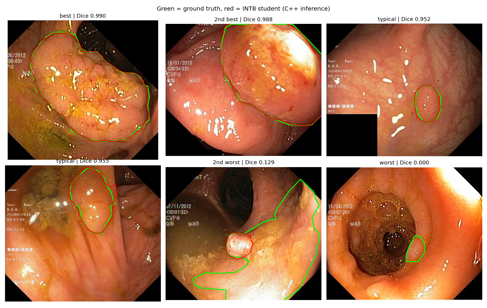
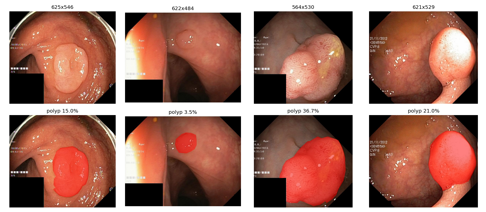
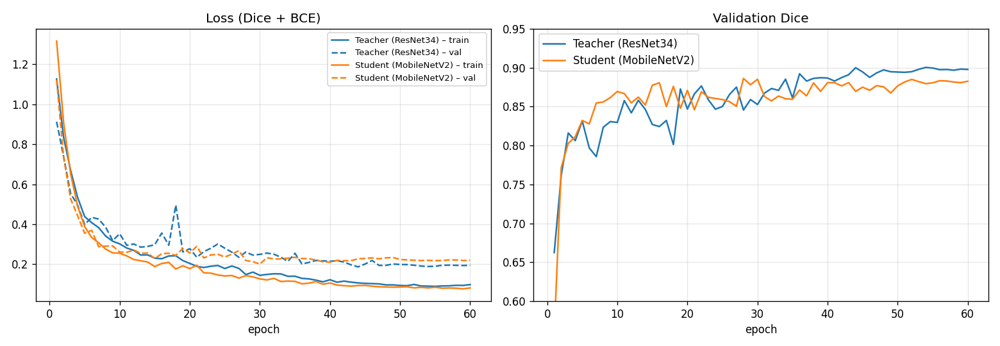
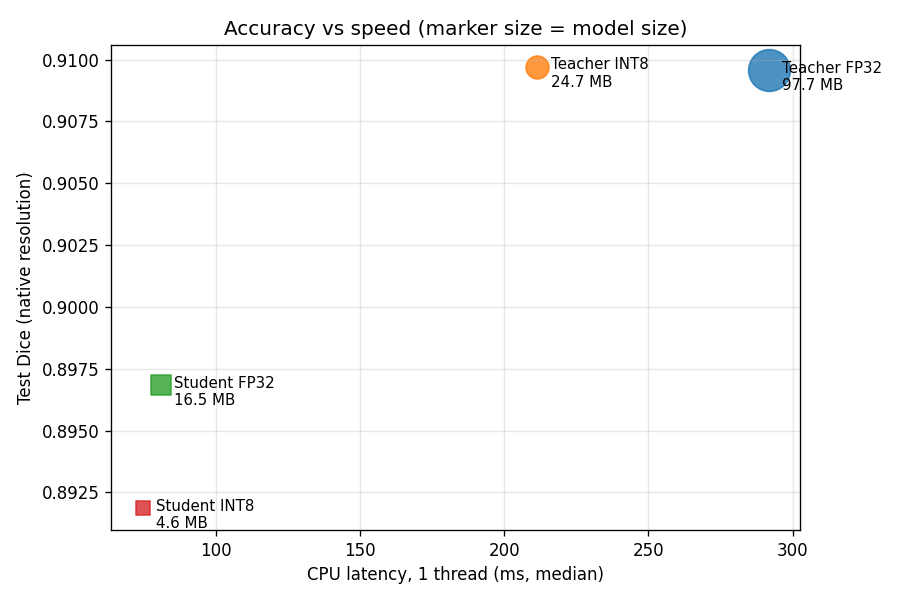
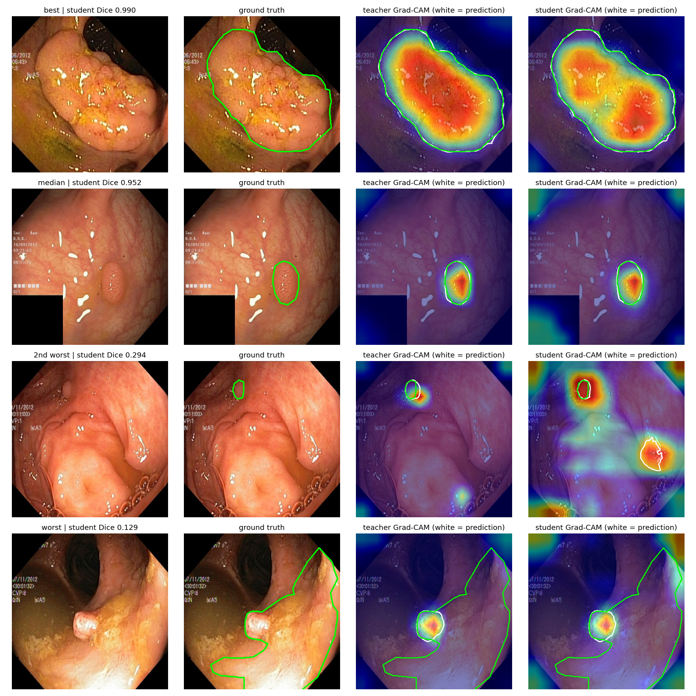

# Efficient & Explainable Polyp Segmentation

Colonoscopy polyp segmentation that is **small enough for a CPU** and **checked for what it actually looks at**.
A U-Net teacher is compressed into a MobileNetV2 student, quantised to INT8, run from **C++**, and analysed with
**Grad-CAM** — every claim backed by paired statistics on a held-out test set.

[](https://colab.research.google.com/github/JamshedAli18/polyp-segmentation-efficient-xai/blob/main/notebook/polyp_segmentation.ipynb)



---

## Contents
1. [Highlights](#highlights)
2. [Pipeline](#pipeline)
3. [Data](#data)
4. [Models and training](#models-and-training)
5. [Results](#results)
6. [Knowledge distillation — a negative result](#knowledge-distillation--a-negative-result)
7. [INT8 quantisation on a CPU without VNNI](#int8-quantisation-on-a-cpu-without-vnni)
8. [Explainability with Grad-CAM](#explainability-with-grad-cam)
9. [C++ inference](#c-inference)
10. [Limitations](#limitations)
11. [Usage](#usage)
12. [Repository structure](#repository-structure)
13. [Data, licences and citations](#data-licences-and-citations)

---

## Highlights

- **21× smaller, 3.9× faster** than the teacher (97.7 MB → 4.6 MB; 292 → 75 ms per image on one CPU thread),
  for **−1.8 Dice points** (0.910 → 0.892 test Dice).
- **INT8 quantisation costs no measurable accuracy** (−0.50 pts, 95% CI [−1.32, +0.34]).
- **C++ deployment** with the ONNX Runtime C++ API: **100% pixel agreement** with Python, 85.7 ms end-to-end.
- **Rigorous evaluation:** fixed held-out test set, scoring at original image resolution, 3 training seeds,
  bootstrap confidence intervals and Wilcoxon signed-rank tests.
- **Honest negative result:** knowledge distillation looked helpful on one seed, but gave **no significant gain**
  across 3 seeds.
- **Quantified explainability:** Grad-CAM shows the student still focuses on the polyp (3× chance level) but its
  attention is **16 points less concentrated** than the teacher's — a cost of compression invisible in Dice.

---

## Pipeline

```
 Kvasir-SEG ─► Teacher U-Net ─► Student U-Net ─► ONNX FP32 ─► ONNX INT8 ─► C++ inference
 1,000 images   ResNet34          MobileNetV2      export        static        ONNX Runtime
 800/100/100    24.4 M params     4.1 M params     (parity       U8S8,         C++ API + OpenCV
                                                    checked)      per-channel
                       └──────────── Grad-CAM analysis (teacher vs student) ────────────┘
```

---

## Data

- **Kvasir-SEG:** 1,000 colonoscopy images with polyp masks annotated by a medical doctor and verified by an
  experienced gastroenterologist.
- **Split:** 800 train / 100 validation / 100 test, **stratified by polyp size** (quartiles), seed 42
  ([`results/split.json`](results/split.json)). The test set was used only for the final benchmark.
- **Preprocessing:** resize to 352×352; ImageNet normalisation.
- **Augmentation (train only):** flips, 90° rotations, affine (scale 0.85–1.15, ±30°), colour jitter.
- **Scoring:** predictions are resized back to each image's **original resolution** before computing Dice / IoU
  (stricter than scoring at 352×352). Polyps cover 0.5%–81% of the image (median 11.4%).



---

## Models and training

| | Teacher | Student |
|---|---|---|
| Architecture | U-Net, ResNet34 encoder (ImageNet) | U-Net, MobileNetV2 encoder (ImageNet), slim decoder (128-64-32-16-16) |
| Parameters | 24.44 M | 4.14 M |
| Loss | Dice + BCE | Dice + BCE |
| Optimiser | AdamW, lr 3e-4, weight decay 1e-4 | same |
| Schedule | 3-epoch warm-up + cosine, 60 epochs | same |
| Other | batch 16, mixed precision (AMP), Tesla T4 | same |

A first teacher run with early stopping stopped before the learning rate decayed (val Dice 0.890); a full
60-epoch cosine schedule reached **0.900** and was used.



---

## Results

**Test set (100 images), original resolution. Latency: ONNX Runtime, median of 200 runs, Intel Xeon @ 2.00 GHz
(Google Colab), 1 thread.**

| Model | Precision | Size | Test Dice | Test IoU | Latency | Speed-up |
|---|---|---|---|---|---|---|
| Teacher | FP32 | 97.7 MB | 0.9096 | 0.8530 | 291.8 ms | 1.00× |
| Teacher | INT8 | 24.7 MB | 0.9097 | 0.8525 | 211.5 ms | 1.38× |
| Student | FP32 | 16.5 MB | 0.8968 | 0.8398 | 81.0 ms | 3.60× |
| **Student** | **INT8** | **4.6 MB** | **0.8919** | **0.8327** | **74.7 ms** | **3.91×** |

**Paired comparisons (per-image Dice, 10,000-sample bootstrap CI, Wilcoxon signed-rank):**

| Comparison | Mean difference | 95% CI | p |
|---|---|---|---|
| INT8 student vs FP32 teacher | −1.77 pts | [−3.77, −0.04] | 0.165 |
| INT8 vs FP32 (student) | −0.50 pts | [−1.32, +0.34] | 0.286 |
| INT8 vs FP32 (teacher) | +0.01 pts | [−0.23, +0.25] | 0.608 |

The compressed model is about 1.8 Dice points below the teacher; the evidence that this gap is real is borderline
(CI just excludes 0, Wilcoxon does not reject). Quantisation itself causes no measurable loss.



---

## Knowledge distillation — a negative result

The student was trained with and without distillation from the teacher (soft-label BCE, α = 0.5, T = 2).

- **Single seed, best-epoch selection:** distillation appeared to help on validation (0.893 vs 0.884) — but
  **reversed on the test set** (0.882 vs 0.890).
- **Fair protocol (fixed in advance):** 3 seeds (42, 43, 44), final-epoch weights only, no best-epoch selection.

| Setup | Validation Dice | Test Dice |
|---|---|---|
| No distillation | 0.8807 ± 0.0024 | **0.8956 ± 0.0019** |
| Distillation | 0.8816 ± 0.0040 | 0.8923 ± 0.0079 |

Per-image difference (3-seed average): **−0.34 pts, 95% CI [−1.27, +0.52], p = 0.47** — no significant effect,
and distillation was less stable across seeds. The first "gain" came from picking a lucky epoch on a 100-image
validation set. **Final model:** no distillation, seed 43 (best final-epoch *validation* Dice, 0.8825).

---

## INT8 quantisation on a CPU without VNNI

- The benchmark CPU supports AVX2 / AVX-512 but **not VNNI**, the instruction set that accelerates 8-bit maths.
- The default signed INT8 format (S8S8) made the student **slower** than FP32 (100 ms vs 82 ms).
- **Fix:** unsigned activations + signed weights with `reduce_range` (U8S8), per-channel, static calibration on
  100 training images → INT8 is now faster than FP32 for both models.
- Conclusion: on non-VNNI CPUs, INT8 mainly buys **size** (3.6–4×); the main **speed** gain comes from the smaller
  architecture.

---

## Explainability with Grad-CAM

Grad-CAM on the deepest encoder stage of each model (stride 32), targeting the predicted polyp mask, on 99 test
images (one image had an empty prediction).

| Metric | Teacher | Student |
|---|---|---|
| Heatmap energy inside the true polyp | **0.638** | **0.475** |
| Chance level (polyp share of the image) | 0.156 | 0.156 |
| Teacher–student heatmap correlation | — | mean 0.862, median 0.893 |

- Both models focus on the polyp, far above chance (4.1× and 3.0×).
- The student looks at **the same regions** as the teacher (correlation 0.86) but spreads more attention into the
  background: **−16.3 pts** energy in the polyp, 95% CI [−18.3, −14.3], p < 0.001.
- **Failure analysis** (figure below):
  - *Compression failure:* the student finds the true polyp but also segments a mucosal fold, with strong
    Grad-CAM activation on it; the teacher does not.
  - *Shared failure:* on a large flat lesion, both models segment only the raised part — a limitation of the
    data/task, not of compression.
  - The student shows weak activations on black image corners and the on-screen text box, a possible shortcut.
- Caveat: the two models have different architectures, so part of the difference may come from how Grad-CAM
  behaves on each network.



---

## C++ inference

[`cpp/segment.cpp`](cpp/segment.cpp) reads images with OpenCV, preprocesses them, runs the INT8 model through the
ONNX Runtime C++ API, resizes the mask to the original resolution and saves it.

| Check | Result |
|---|---|
| Pixel agreement with Python | **100.000%** (mean and minimum over 100 test images) |
| Test Dice | 0.8919 (identical to Python) |
| End-to-end latency, 1 thread | 85.7 ms median, 138.3 ms p95 (read excluded; preprocess + inference + resize) |

Build (Linux, ONNX Runtime 1.20.1, OpenCV 4):
```bash
wget https://github.com/microsoft/onnxruntime/releases/download/v1.20.1/onnxruntime-linux-x64-1.20.1.tgz
tar -xzf onnxruntime-linux-x64-1.20.1.tgz
ORT=onnxruntime-linux-x64-1.20.1
g++ -O3 -std=c++17 cpp/segment.cpp -o segment -I$ORT/include -L$ORT/lib -lonnxruntime \
    $(pkg-config --cflags --libs opencv4) -Wl,-rpath,$ORT/lib
./segment models/student_mnv2_int8.onnx image_list.txt out_dir 1
```

---

## Limitations

- One dataset (Kvasir-SEG, 1,000 images) and a 100-image test set; no external validation on other hospitals or
  devices.
- Latency measured on a shared cloud vCPU; absolute numbers vary by machine, relative comparisons hold.
- Energy was not measured: on a virtual CPU, CodeCarbon only estimates power from runtime.
- Grad-CAM is one explanation method; heatmaps from different architectures are not perfectly comparable.
- A research project, **not a medical device**.

---

## Usage

**Run the model on an image (CPU only):**
```bash
pip install onnxruntime opencv-python numpy
python infer.py path/to/colonoscopy.jpg --out prediction.png
```

**Reproduce everything:** open the notebook in Colab (badge above), select a T4 GPU and run the cells in order.
The notebook downloads Kvasir-SEG from the official source.

---

## Repository structure

```
polyp-segmentation-efficient-xai/
├── notebook/polyp_segmentation.ipynb   # full pipeline: data, training, KD, ONNX/INT8, benchmark, Grad-CAM, C++
├── cpp/segment.cpp                     # C++ inference (ONNX Runtime + OpenCV)
├── models/student_mnv2_int8.onnx       # final model (4.6 MB)
├── infer.py                            # Python inference on one image
├── figures/                            # README figures
├── results/                            # benchmark, KD, Grad-CAM results, training histories, split
├── requirements.txt
└── LICENSE
```

---

## Data, licences and citations

- **Code:** MIT — see [`LICENSE`](LICENSE).
- **Kvasir-SEG** is used for research and educational purposes; the dataset is not redistributed (only image IDs
  in `split.json` and a few example figures). Please cite:
  D. Jha, P. H. Smedsrud, M. A. Riegler, P. Halvorsen, T. de Lange, D. Johansen, H. D. Johansen,
  *Kvasir-SEG: A Segmented Polyp Dataset*, MultiMedia Modeling (MMM), 2020.
  Dataset: https://datasets.simula.no/kvasir-seg/
- Built with [segmentation-models-pytorch](https://github.com/qubvel-org/segmentation_models.pytorch),
  [ONNX Runtime](https://onnxruntime.ai) and [pytorch-grad-cam](https://github.com/jacobgil/pytorch-grad-cam).

## Author

**Jamshed** — [github.com/JamshedAli18](https://github.com/JamshedAli18)